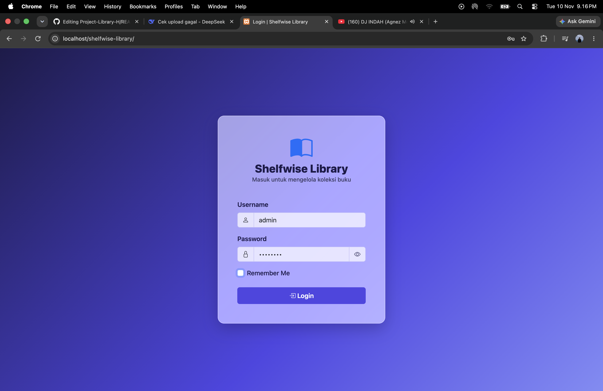
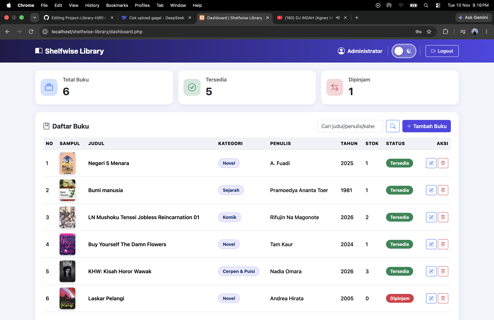
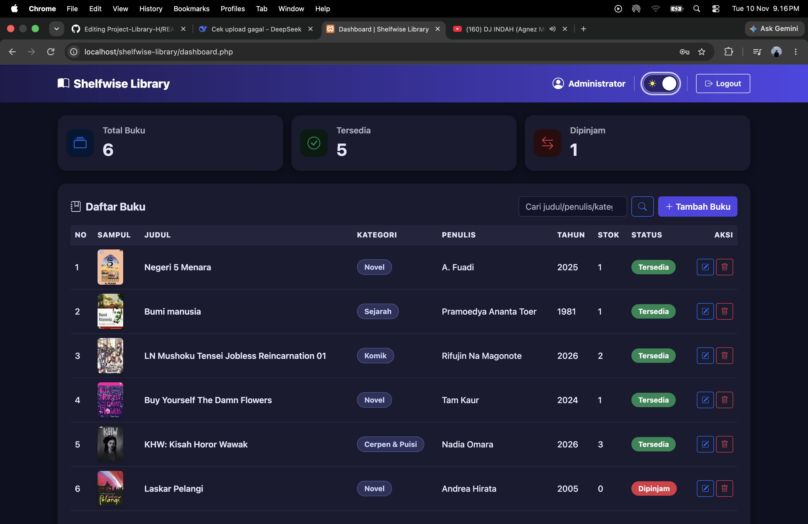
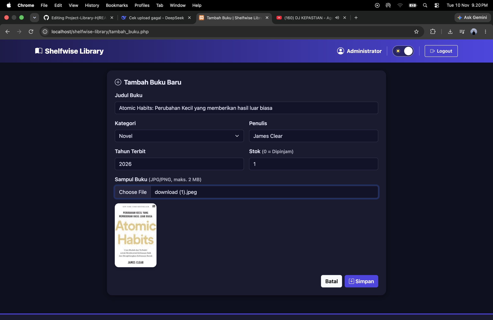
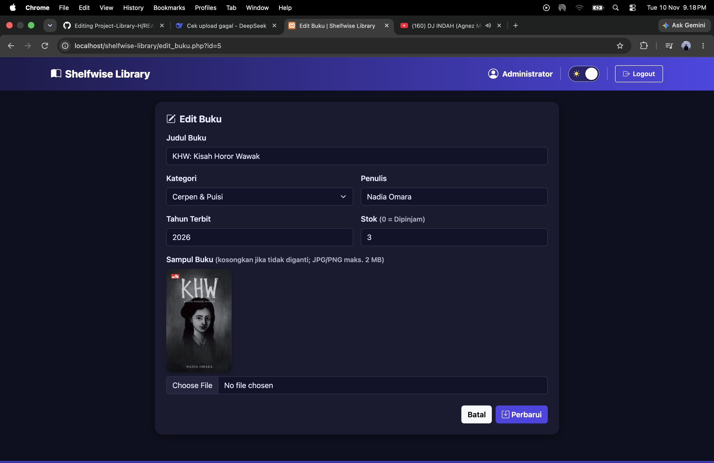
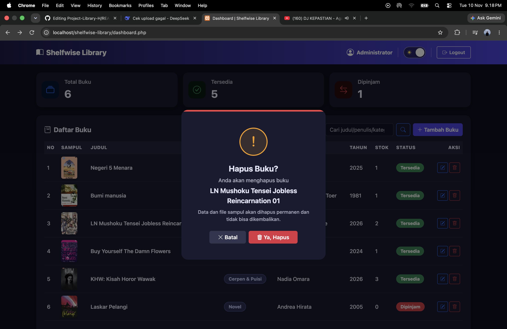
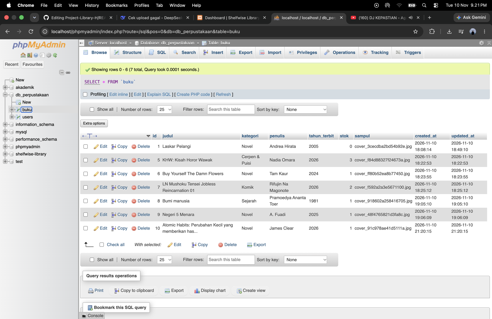

# Shelfwise Library

Sistem Informasi Perpustakaan Digital Mini berbasis **PHP Native + MySQL (mysqli)** dengan autentikasi Session & Cookie, CRUD data buku, dan upload sampul.

| | |
|---|---|
| **Nama** | Ahmad Rafiq Hakim |
| **NPM** | 2513020081 |

## Video Demo

> Link YouTube: 

&nbsp;

&nbsp;

---

## Fitur

- **Login** (POST) dengan `password_hash` / `password_verify`, `session_regenerate_id`, dan token CSRF
- **Session**: Dashboard & seluruh halaman CRUD hanya bisa diakses setelah login
- **Cookie "Remember Me"**: menyimpan username di browser selama 30 hari
- **Logout**: menghapus session & cookie lalu redirect ke login
- **CRUD Buku**: tambah, tampil (tabel + pencarian + statistik), edit, hapus
- **Upload sampul**: validasi ekstensi (jpg/jpeg/png), MIME asli, ukuran maks 2 MB, nama file acak
- **Ganti sampul** otomatis menghapus file lama; **hapus buku** otomatis `unlink` file gambar
- **Logika bisnis**: `stok > 0` → **Tersedia**, `stok = 0` → **Dipinjam** (`label_status()` di `includes/helpers.php`)
- **UI**: Bootstrap 5.3 + Bootstrap Icons +; login dengan tombol lihat password
- **Tema gelap/terang** (tersimpan di browser), animasi halus, modal hapus dengan ikon peringatan, footer di bawah halaman
- **Kategori** dipilih lewat dropdown (daftar ada di `KATEGORI_BUKU` pada `includes/helpers.php`)
- **Keamanan**: prepared statements, escaping output (`htmlspecialchars`), hapus via POST + CSRF, `.htaccess` di folder uploads

## Teknologi

PHP 8.1+ (Native) · MySQL/MariaDB · mysqli · Bootstrap 5 · JavaScript

## Cara Menjalankan

1. Pasang XAMPP / Laragon (PHP 8.1+).
2. Clone repo ke folder `htdocs`:
   ```bash
   git clone <url-repo-anda> shelfwise-library
3. Buka phpMyAdmin → Import file db_perpustakaan.sql (otomatis membuat database db_perpustakaan).
4. Sesuaikan kredensial di config/koneksi.php bila perlu.
5. Buka http://localhost/shelfwise-library/.
   git clone <url-repo-anda> shelfwise-library

   Akun demo: username admin · password password

shelfwise-library/
├── config/koneksi.php        # Koneksi MySQL
├── includes/
│   ├── auth.php              # Session & proteksi halaman
│   ├── helpers.php           # Escape, flash, CSRF, upload, validasi, label status
│   ├── header.php            # Layout atas (navbar)
│   └── footer.php            # Layout bawah
├── assets/css/style.css
├── assets/js/app.js
├── uploads/                  # Sampul buku
├── index.php                 # Halaman login
├── proses_login.php          # Autentikasi + Session/Cookie
├── logout.php                # Hapus Session & Cookie
├── dashboard.php             # Read + menu
├── tambah_buku.php           # Form tambah
├── proses_tambah.php         # Insert + upload
├── edit_buku.php             # Form edit
├── proses_edit.php           # Update + ganti file
├── hapus_buku.php            # Delete + unlink file
└── db_perpustakaan.sql       # Ekspor database

Screenshot

Halaman	Screenshot
Login	
Dashboard (Read)	
Dashboard Dark (Read)	
Tambah Buku (Create)	
Edit Buku (Update)	
Konfirmasi Hapus (Delete)	
Phpmyadmin (Database) 

